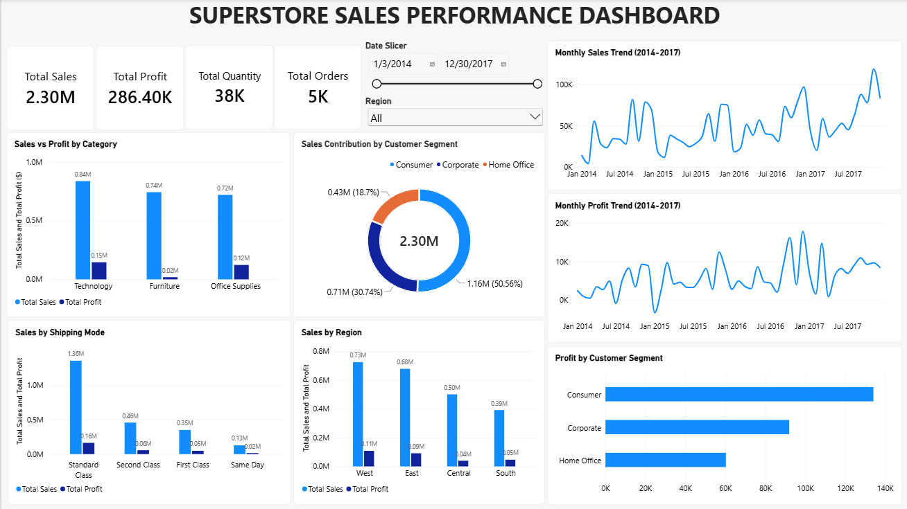

# Superstore Sales Data Analysis

## Project Overview
This project analyzes the Superstore sales dataset to identify business trends, evaluate sales and profitability, and generate actionable business insights using Python and Microsoft Power BI.

## Project Objectives
- Clean and prepare the sales dataset.
- Analyze sales and profit trends.
- Identify top-performing categories, products, and regions.
- Evaluate customer segments and shipping modes.
- Identify loss-making products and areas for improvement.
- Develop an interactive Power BI dashboard.

## Tools & Technologies
- **Python:** Data analysis and visualization
- **Pandas & NumPy:** Data cleaning and manipulation
- **Matplotlib:** Data visualization
- **Jupyter Notebook:** Exploratory data analysis
- **Microsoft Power BI:** Interactive dashboard development
- **Excel/CSV:** Dataset handling

## Dataset Overview
- Total records: 9,994
- Total columns: 21
- Unique orders: 5,009
- Unique customers: 793
- Product categories: Furniture, Office Supplies, Technology

## Project Workflow
1. Dataset loading and exploration
2. Data cleaning and preprocessing
3. Exploratory Data Analysis (EDA)
4. Category, region, segment, and shipping analysis
5. Product profitability analysis
6. Monthly sales and profit trend analysis
7. Business insights and recommendations
8. Power BI dashboard development

## Key Business Insights
- Total sales were approximately **$2.30 million**.
- Total profit was approximately **$286.40K**.
- Technology generated the highest sales and profit among the three categories.
- The West region recorded the highest sales and profit.
- The Consumer segment contributed the largest share of sales.
- Furniture had relatively low profitability compared with its sales.
- Some products, particularly tables, generated significant losses.
- Standard Class shipping contributed the highest sales and profit.

## Power BI Dashboard
The interactive dashboard includes:
- Total Sales, Total Profit, Total Orders, and Total Quantity KPIs.
- Sales vs Profit by Category.
- Sales vs Profit by Region.
- Customer Segment analysis.
- Sales vs Profit by Shipping Mode.
- Monthly Sales and Profit Trends.
- Region and Order Date slicers.

## Dashboard Preview

## Project Files
- `sales-data-analysis.ipynb` — Python analysis notebook
- `Superstore_Cleaned.csv` — Cleaned dataset
- `Superstore_Sales_Performance_Dashboard.pbix` — Power BI dashboard

## Author
**Pranav Salunke**

Computer Science Student | Aspiring Data Analyst

